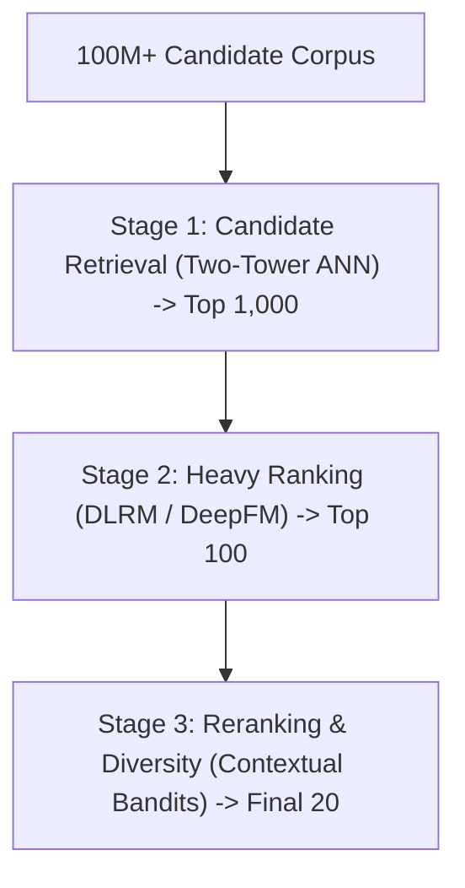

# Two-Tower Recommendation System Architecture (Meta / Netflix)

> **Target Companies**: Meta, Netflix, Google, ByteDance (Senior Machine Learning Engineer)  
> **Scale**: 1 Billion users, 100 Million candidate items, $<50$ms end-to-end response budget

---

## 1. The Multi-Stage Recommendation Funnel

---

## 2. Two-Tower Architecture Breakdown

- **User Tower**: Computes a dense vector representation $u \in \mathbb{R}^d$ from user history, demographics, and real-time context (time of day, device).
- **Item Tower**: Computes a dense vector representation $v \in \mathbb{R}^d$ from item metadata, embeddings, and category.
- **Matching Score**: Dot product $\langle u, v \rangle$ or cosine similarity.

### Real-Time Vector Indexing
Item embeddings are computed offline and indexed in an approximate nearest neighbor (ANN) vector database (FAISS, Google ScaNN, or HNSW).
At query time:
1. User passes through user tower in $\approx 4$ms.
2. Vector query against ScaNN retrieves top 1,000 candidates in $\approx 8$ms.
3. Top 1,000 fed into Deep & Cross / DLRM model for pointwise CTR prediction.
