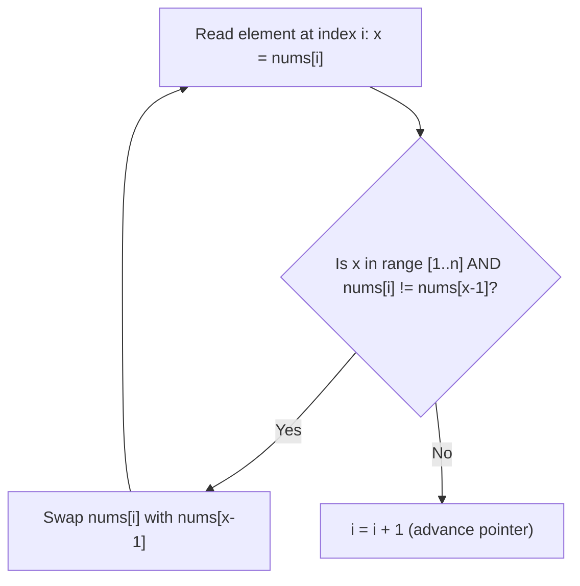

# Cyclic Sort & In-Place State Encodings

> **Target Companies**: Amazon, Meta, Google, Microsoft (L4/L5 SWE)  
> **Key Frequency**: Highest yield pattern for "Find missing/duplicate numbers in [1..n] in O(n) time and O(1) space"

---

## 1. The Core Mental Model

The standard interview trap is reaching for a hash set or sorting:
- **Hash Set**: $O(n)$ time, but consumes $O(n)$ extra memory. Disqualified if the prompt demands $O(1)$ auxiliary space.
- **Comparison Sort**: $O(n \log n)$ time, violates the $O(n)$ runtime constraint.

### The Invariant
When an array contains $n$ numbers within the range $[1..n]$ (or $[0..n]$), **each value itself is an implicit index**.
A correctly placed element $v$ must sit at position $v - 1$.
The Cyclic Sort pattern executes a cycle of in-place swaps until every number is either:
1. Sitting at its designated index (`nums[i] == nums[nums[i] - 1]`), or
2. Out-of-bounds (e.g. negative or $> n$ in *First Missing Positive*).

```
Index:  [ 0,  1,  2,  3 ]
Value:  [ 3,  1,  4,  2 ]  --> Target: [ 1,  2,  3,  4 ]
```

---

## 2. Invariants & Step-by-Step Cycle Walkthrough



### Why is this strictly $O(n)$ time?
At each iteration:
- Either the index $i$ increments by $1$, OR
- An element is swapped into its permanent home.
Since each of the $n$ elements can be placed into its correct home at most **once**, the maximum number of swaps across the entire loop is $n - 1$.
$$\text{Total Operations} \le n + (n - 1) = 2n - 1 = O(n)$$

---

## 3. Production Python Blueprint: First Missing Positive (LeetCode 41 Hard)

```python
from typing import List

def first_missing_positive(nums: List[int]) -> int:
    """
    Finds the smallest positive integer not in nums in O(n) time and O(1) auxiliary space.
    """
    n = len(nums)
    i = 0
    while i < n:
        correct_idx = nums[i] - 1
        # Place nums[i] at correct_idx if in range [1, n] and not already there
        if 0 <= correct_idx < n and nums[i] != nums[correct_idx]:
            nums[i], nums[correct_idx] = nums[correct_idx], nums[i]
        else:
            i += 1

    # Second pass: first index where nums[i] != i + 1 is the missing positive
    for i in range(n):
        if nums[i] != i + 1:
            return i + 1

    return n + 1

# Verification test assertions
assert first_missing_positive([3, 4, -1, 1]) == 2
assert first_missing_positive([1, 2, 0]) == 3
assert first_missing_positive([7, 8, 9, 11, 12]) == 1
```

---

## 4. Alternate In-Place Encoding: The Negative-Sign Flag
When an array contains integers in range $[1..n]$ and you cannot move elements:
Use the **sign of the value at index $(|val| - 1)$ as a 1-bit seen boolean**:
- To mark seen: `nums[abs(x) - 1] = -abs(nums[abs(x) - 1])`
- If already negative before marking $\to$ duplicate found!

---

## 5. Mock Interview Traps & Diagnostics
1. **Infinite Loop Pitfall**: Doing `nums[i] != i + 1` instead of `nums[i] != nums[correct_idx]`. If duplicate numbers exist (e.g. `[2, 2]`), checking index causes an infinite loop!
2. **0-indexed vs 1-indexed shift**: Always map values $1..n$ to indices $0..n-1$ with `val - 1`.
