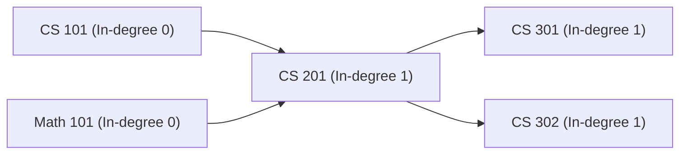

# Topological Sort & DAG Dependency Resolution

> **Target Companies**: Google, Uber, Apple, Airbnb (L5 Senior SWE)  
> **Key Frequency**: Course Schedule, Build Systems, Package Resolvers, Lexicographical Dictionaries

---

## 1. The Core Mental Model

A **Topological Ordering** of a Directed Acyclic Graph (DAG) is a linear sequence of vertices such that for every directed edge $u \to v$, $u$ appears before $v$.

### Two Core Algorithms Compared
| Algorithm | Mechanism | Time Complexity | Cycle Detection Mechanism |
| :--- | :--- | :--- | :--- |
| **Kahn's Algorithm (BFS)** | Track In-Degree of each node | $O(V + E)$ | Count of processed nodes $< V$ |
| **Tarjan's Post-Order (DFS)** | 3-Color State (White/Gray/Black) | $O(V + E)$ | Reaching a node currently in State Gray (Visiting) |

---

## 2. Invariants & Kahn's In-Degree Walkthrough



1. Initialize `in_degree = [0] * numCourses`.
2. Push all nodes with `in_degree == 0` into a queue.
3. Pop from queue, append to result order, decrement in-degree for all outgoing neighbors.
4. If neighbor's in-degree drops to 0, push into queue.

---

## 3. Production Python Blueprint: Course Schedule II (LeetCode 210)

```python
from collections import deque, defaultdict
from typing import List

def find_order(num_courses: int, prerequisites: List[List[int]]) -> List[int]:
    """
    Returns a valid topological ordering or empty list if a dependency cycle exists.
    """
    adj = defaultdict(list)
    in_degree = [0] * num_courses

    for dest, src in prerequisites:
        adj[src].append(dest)
        in_degree[dest] += 1

    queue = deque([i for i in range(num_courses) if in_degree[i] == 0])
    order = []

    while queue:
        node = queue.popleft()
        order.append(node)
        for nxt in adj[node]:
            in_degree[nxt] -= 1
            if in_degree[nxt] == 0:
                queue.append(nxt)

    return order if len(order) == num_courses else []

# Verification
assert find_order(4, [[1,0],[2,0],[3,1],[3,2]]) in ([0,1,2,3], [0,2,1,3])
assert find_order(2, [[1,0],[0,1]]) == [] # Cycle
```

---

## 4. Advanced Variant: Alien Dictionary (Lexicographical Order)
When given a sorted list of words in an alien language:
1. Compare adjacent words `words[i]` and `words[i+1]`.
2. Find the first differing character: `w1[k] -> w2[k]` defines a directed edge.
3. Validate prefix invariant: If `w1` is longer than `w2` and starts with `w2`, order is invalid (e.g. `["abc", "ab"]`).
4. Run Kahn's algorithm or Tarjan's DFS with cycle check.
