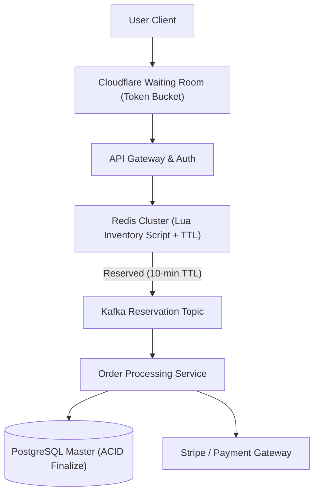

# Flash Sale & High-Concurrency Ticket Reservation (Ticketmaster)

> **Target Companies**: Amazon, Apple, Booking.com, Ticketmaster  
> **Scale**: 100,000 QPS, 50,000 concurrent buyers competing for 5,000 seats

---

## 1. The Core Architectural Challenge

When popular concert tickets or Apple devices drop, thousands of requests arrive in the first 500 milliseconds.
- **RDBMS row locking (`SELECT ... FOR UPDATE`)**: Deadlocks and exhausts the connection pool under $>2,000$ concurrent writes.
- **Naive NoSQL writes**: Incur double-booking and inventory overshoot under distributed partition failures.

---

## 2. End-to-End System Architecture



---

## 3. High-Concurrency Reservation Invariants

### 1. Atomic Lua Script in Redis
Redis executes Lua scripts atomically in a single thread, eliminating multi-process race conditions entirely.

```lua
-- KEYS[1]: event_inventory_key (e.g. 'inventory:concert_101:zone_A')
-- ARGV[1]: requested_quantity (e.g. 2)
-- ARGV[2]: user_id
-- ARGV[3]: hold_ttl_seconds (e.g. 600)

local current_stock = tonumber(redis.call('get', KEYS[1]) or '0')
local qty = tonumber(ARGV[1])

if current_stock >= qty then
    redis.call('decrby', KEYS[1], qty)
    local reservation_key = 'hold:' .. KEYS[1] .. ':' .. ARGV[2]
    redis.call('setex', reservation_key, tonumber(ARGV[3]), qty)
    return 1 -- Success
else
    return 0 -- Sold out / insufficient inventory
end
```

### 2. The 10-Minute Reservation Hold & TTL Auto-Reclamation
If the user abandons checkout:
- Key in Redis expires automatically via `setex`.
- A Redis Keyspace Notification or periodic reconciliation worker refunds uncompleted seats back to `inventory:concert_101:zone_A`.

---

## 4. Preventing Double-Spending: Fencing Tokens & Distributed Locks

When using distributed locks (Redlock / ZooKeeper):
```
Client 1 acquires Lock -> Pauses due to GC/Network hiccup -> Lock expires
Client 2 acquires Lock -> Writes to DB
Client 1 wakes up -> Writes stale data to DB (Corrupting state!)
```
**Fix**: Append a strictly monotonic **Fencing Token** to every lock acquisition.
PostgreSQL checks: `UPDATE inventory SET count = ... WHERE token > last_applied_token`.
