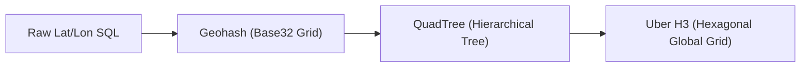

# Proximity Service & Location-Based Systems (Google Maps / Uber)

> **Target Companies**: Google, Uber, Yelp, DoorDash (Staff L5/L6)  
> **Core Metric**: Sub-20ms radius queries across 200,000,000 venues & drivers

---

## 1. Comparing Spatial Indexing Approaches



| Index Type | Structure | In-Memory / Disk | Nearest Neighbors Handling |
| :--- | :--- | :--- | :--- |
| **Geohash** | Interleaves lat/lon bits into Base32 string | Key-Value Store (Redis / DynamoDB) | Border boundary issues (requires checking 8 adjacent neighbors) |
| **QuadTree** | 4-way recursive spatial tree | In-Memory (Node.js / Go microservice) | Dynamic re-balancing required under population density |
| **Uber H3** | Global discrete hexagonal grid system | Bitwise integer representations | Equal distance to all 6 adjacent neighbors (ideal for rideshare) |

---

## 2. Geohash Index Architecture

A Geohash breaks the earth into binary subdivided rectangles:
- Precision 5: $\approx 4.9 \text{ km} \times 4.9 \text{ km}$
- Precision 6: $\approx 1.2 \text{ km} \times 0.61 \text{ km}$ (Ideal neighborhood scale)

### Database Storage Schema (Redis / DynamoDB)
```
Partition Key: geohash_prefix_4 (e.g. '9q8y')
Sort Key:      geohash_prefix_6 (e.g. '9q8yzh')
Attributes:    restaurant_id, name, lat, lon, rating
```

Querying 3 km radius around user:
1. Calculate user's 6-character geohash.
2. Query user's geohash + 8 surrounding neighbor hashes.
3. Compute exact Haversine distance in-memory to filter edge discrepancies.
