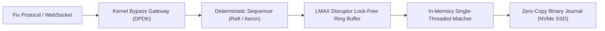

# Ultra-Low Latency Stock Exchange & Order Matching Engine

> **Target Companies**: Robinhood, Coinbase, Citadel, Jump Trading (L5/L6 Low-Latency SWE)  
> **Key Metric**: Sub-microsecond (99.9th percentile $< 5 \mu s$) deterministic matching

---

## 1. Architecture of a Modern Matching Engine

Traditional enterprise architectures (microservices, JSON HTTP, distributed transactions) are disqualified by orders of magnitude:
- Network roundtrip over HTTP: $5,000 \mu s$
- Linux kernel context switch: $1.5 \mu s$
- Memory allocation & Java/Node GC pause: $10,000 \mu s$ to $100,000 \mu s$

---

## 2. The LMAX Disruptor Pattern
Instead of standard thread-safe queues with lock contention:
- A single pre-allocated circular ring buffer (power of 2 size).
- Sequence numbers managed with atomic CAS (`AtomicLong`) operations.
- Zero CPU cache-line bouncing (cache line padding around sequence counters).

---

## 3. Order Book Data Structure: Price-Time Priority
- **Price Levels**: Balanced Binary Search Tree (Red-Black) or B-Tree of limit prices.
- **At Each Price**: Doubly Linked List of Orders (FIFO queue for time priority).
- **Lookup Map**: Hash map of `order_id -> OrderNode` for $O(1)$ cancelation and amendment.
